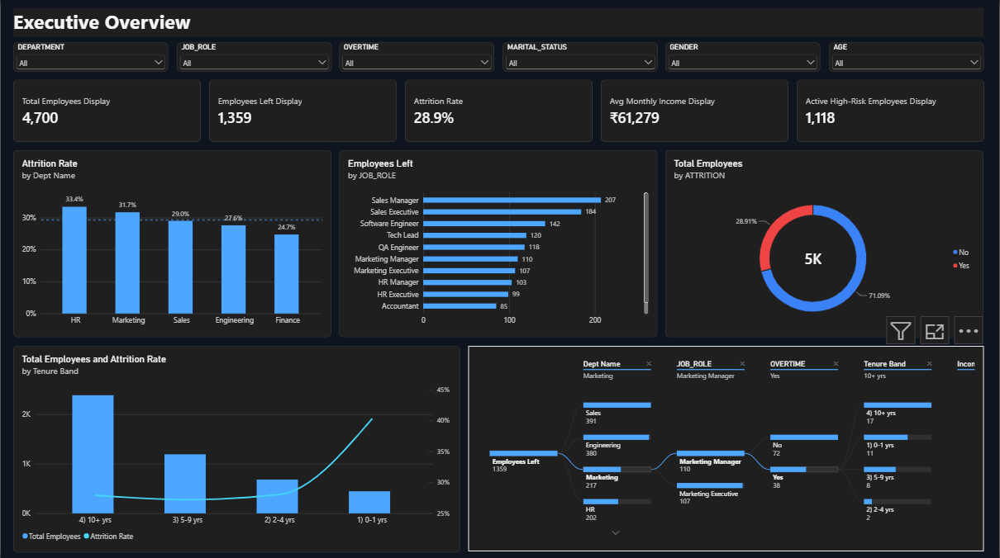
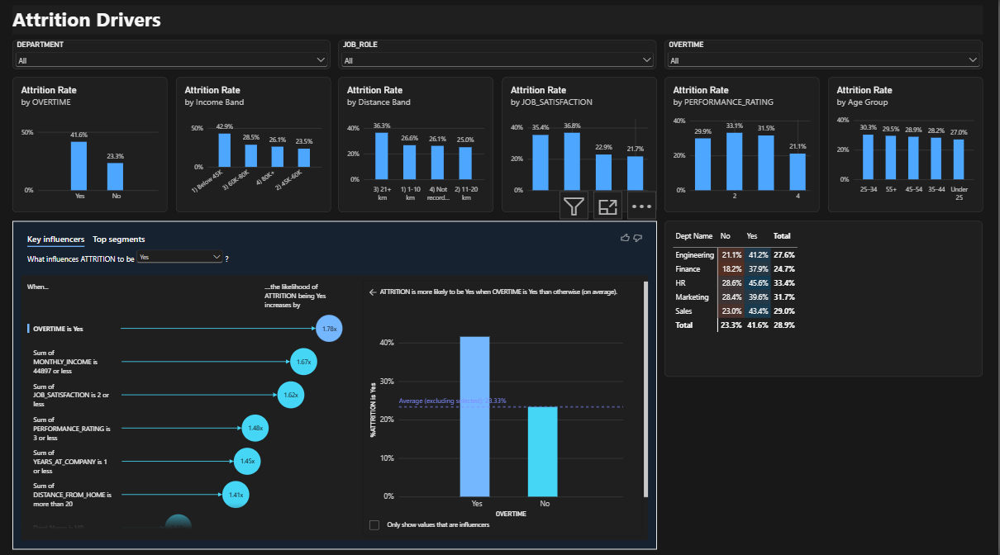
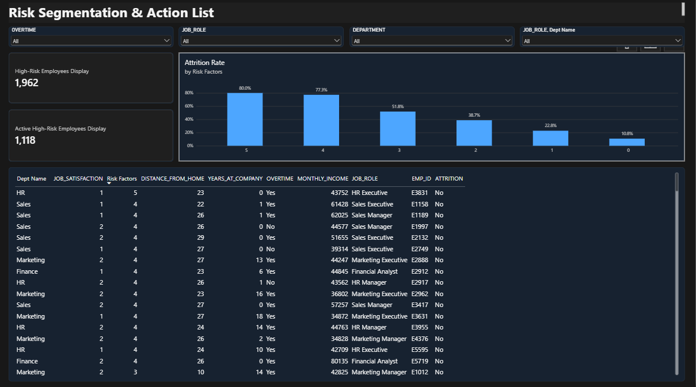

# 🏢 Attrition IQ – HR Employee Attrition Analysis

Why do employees leave, and can we spot the ones at risk before they do?

I built this project end to end to answer that question: from raw data in the cloud, to a SQL warehouse, to a machine learning model, to a Power BI dashboard that an HR team could actually use.

---

## 📌 What this project covers

- Stored the raw HR data on **AWS S3** and loaded it into **Snowflake**
- Explored and cleaned the data in **Python** (EDA)
- Trained a **Random Forest** model to predict attrition risk
- Built a 3-page **Power BI dashboard** with drill-downs and an action list of at-risk employees
- Built and deployed a **Streamlit** app for live predictions (see the note below)

---

## 📊 Power BI Dashboard

### Page 1 – Executive Overview
Headline numbers (4,700 employees, 1,359 left, 28.9% attrition), attrition by department, job role and tenure, and a decomposition tree to drill into who is leaving.



### Page 2 – Attrition Drivers
Attrition rate by overtime, income, commute distance, job satisfaction, performance rating and age, plus a Key Influencers visual that ranks what pushes attrition up.



### Page 3 – Risk Segmentation & Action List
Employees scored by number of risk factors (overtime, low satisfaction, long commute, short tenure, low income), with a list of still-active high-risk employees that HR can act on.



The dashboard file is in the `powerbi/` folder (open it with Power BI Desktop).

---

## 💡 What the data says

- **28.9%** of employees have left (1,359 out of 4,700).
- **Overtime is the biggest driver:** 41.6% attrition for people working overtime, against 23.3% for those who don't.
- **Pay matters:** employees earning below ₹45K leave at 42.9%, compared with roughly 23–29% in the higher income bands.
- **Long commutes hurt:** employees living 21+ km away leave at 36.3%, versus about 25–27% for shorter distances.
- **Satisfaction shows up in the numbers:** scores of 1–2 see 35–37% attrition, scores of 3–4 around 22%.
- **HR (33.4%) and Marketing (31.7%)** have the highest attrition. Finance has the lowest at 24.7%.
- **Risk stacks up:** attrition goes from 10.8% with no risk factors to 80% with all five.
- **1,118 current employees are high-risk**, which makes them the natural first target for retention efforts.

---

## 🤖 Machine Learning Model

- **Goal:** predict whether an employee will leave (Yes / No)
- **Features:** age, department, job role, gender, marital status, performance rating, overtime, distance from home, monthly income, years at company, job satisfaction
- **Preprocessing:** label encoding for categories, median fill for missing numeric values
- **Split:** 80/20 train/test, stratified
- **Class imbalance:** handled with SMOTE on the training data only, so the test set stays untouched and the evaluation is honest
- **Model:** Random Forest, tuned with GridSearchCV (3-fold CV, optimized for F1-score) over `n_estimators`, `max_depth` and `min_samples_split`
- **Output:** attrition risk with probability, plus feature importance showing the top drivers

---

## 🖥️ Streamlit App – deployment note

I deployed a Streamlit app (dashboard + attrition prediction) on Streamlit Community Cloud, with Snowflake as its data source.

**The live link is no longer active.** The Snowflake trial account it depended on has expired, so the app can no longer fetch its data. I've kept the code in this repo (`app.py`) so the work is still visible. The Power BI dashboard above is independent of this and fully covers the analysis.

---

## 🛠️ Tech Stack

AWS S3 · Snowflake · Python (pandas, NumPy, scikit-learn, imbalanced-learn, matplotlib, seaborn) · Streamlit · Plotly · Power BI

---

## 📁 Repository Structure

```
Attrition_IQ/
├── src/                 # Snowflake connection, EDA and model training scripts
├── models/              # Trained model (.pkl)
├── powerbi/             # Power BI file (.pbix)
├── powerbi/             # Power BI file (.pbix) and dashboard screenshots
├── app.py               # Streamlit app
├── main.py              # Runs the pipeline end to end
├── requirements.txt
└── README.md
```

---

## 👤 Author

**Aditya Gupta**
[GitHub](https://github.com/aditya18-prog)
